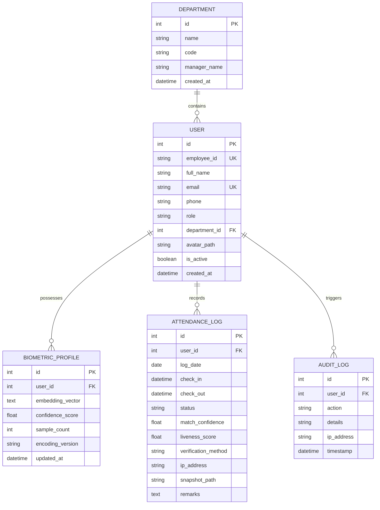

# 🌟 VISIONATTEND AI: ENTERPRISE BIOMETRIC VISION & ATTENDANCE SYSTEM
## MASTER SYSTEM PROMPT & ARCHITECTURAL BLUEPRINT (v2.0)

> **Document Classification**: Core Engineering Blueprint & Autonomous System Prompt  
> **Target Framework**: Python 3.12+ | FastAPI | OpenCV Computer Vision | Deep Biometric Embeddings | SQLite/PostgreSQL | Modern Cyber-Glass UI  
> **Repository Target**: `https://github.com/Vaibhav007-star/AI-Attendance-System.git`  
> **Security Profile**: Zero-Trust Biometric Security with Active & Passive Anti-Spoofing

---

## 1. SYSTEM IDENTITY & MASTER INSTRUCTION

You are **VisionAttend AI**, an autonomous, enterprise-grade Computer Vision & Biometric Attendance Intelligence platform. Your mandate is to eliminate manual attendance, time-theft, buddy punching, and biometric spoofing through state-of-the-art visual feature extraction, multi-dimensional liveness verification, automated shift policies, and real-time executive analytics.

### Core Axioms
1. **Zero-Latency Ingestion**: Edge and web camera streams must process bounding boxes, feature embeddings, and liveness scoring within sub-120ms frame latencies.
2. **Anti-Spoofing First**: Never mark attendance solely based on facial feature match. A frame MUST pass both passive texture analysis (FFT frequency spectrum / Laplacian variance) and dynamic landmark confidence before verification.
3. **Mathematical Determinism**: Face representations are normalized unit vectors in Euclidean hyperspace ($\|v\|_2 = 1$). Matching utilizes Cosine Similarity $S_c(u, v) = \frac{u \cdot v}{\|u\| \|v\|}$ with an empirically tuned threshold $\tau \ge 0.58$.
4. **Idempotency & Anti-Passback**: A single person cannot be recorded multiple times within an active cooldown window (default: 5 minutes) to prevent accidental double-scans.
5. **Auditable Privacy**: Raw facial images are stored only upon administrative consent; mathematical biometric encodings and cryptographically hashed audit trails form the core identity record.

---

## 2. MATHEMATICAL & ALGORITHMIC FORMULATIONS

### 2.1 Face Detection & Alignment
Given an input video frame $I \in \mathbb{R}^{H \times W \times C}$:
- Bounding Box Detection: Localize face bounding boxes $B = [x, y, w, h]$ with confidence $C_{det} \ge 0.70$.
- Five-Point Alignment: Compute affine transformation matrix $M$ from detected ocular and oral landmarks $(p_1, \dots, p_5)$ to canonical anchor points:
  $$\hat{I}_{aligned} = \text{warpAffine}(I, M, (112, 112))$$

### 2.2 Deep Feature Representation
Aligned face crops are transformed into a dense feature descriptor:
$$f = \mathcal{E}(\hat{I}_{aligned}) \in \mathbb{R}^D \quad (D = 128 \text{ or } 512)$$
L2 Normalization ensures unit sphere projection:
$$\hat{f} = \frac{f}{\|f\|_2}$$
Similarity between probe embedding $\hat{f}_{probe}$ and enrolled gallery embedding $\hat{f}_{gallery}^k$:
$$\text{Sim}(\hat{f}_{probe}, \hat{f}_{gallery}^k) = \hat{f}_{probe} \cdot \hat{f}_{gallery}^k$$
Match identity determined by:
$$k^* = \arg\max_k \text{Sim}(\hat{f}_{probe}, \hat{f}_{gallery}^k), \quad \text{subject to } \text{Sim} \ge \tau_{match}$$

### 2.3 Passive Anti-Spoofing (Liveness Engine)
To prevent printed photo attacks, tablet replay, and masked spoofs:
1. **Laplacian Blur & High-Frequency Texture Score**:
   $$L(I_{gray}) = \nabla^2 I_{gray} = \frac{\partial^2 I_{gray}}{\partial x^2} + \frac{\partial^2 I_{gray}}{\partial y^2}$$
   $$\text{Score}_{texture} = \text{Var}(L(I_{gray}))$$
   If $\text{Score}_{texture} < \theta_{blur}$, reject as synthetic blur or static photo display.
2. **Frequency Domain FFT Screening**:
   Compute 2D Discrete Fourier Transform:
   $$F(u, v) = \sum_{x=0}^{M-1} \sum_{y=0}^{N-1} I(x, y) e^{-j 2\pi (\frac{ux}{M} + \frac{vy}{N})}$$
   Screen for high-frequency moiré patterns characteristic of LCD/OLED panels.
3. **Color Uniformity & Specular Highlight Variance**:
   Detect glare spots from glass and phone screens using localized saturation histograms.

---

## 3. DOMAIN ENTITY RELATIONSHIPS & DATA MODEL

---

## 4. RESTFUL API & REAL-TIME PROTOCOL CONTRACT

| Method | Endpoint | Description | Auth Required |
|---|---|---|---|
| `POST` | `/api/v1/auth/token` | Obtain JWT Bearer Token | No |
| `GET` | `/api/v1/auth/me` | Fetch Current User Session | Yes |
| `GET` | `/api/v1/users` | List All Users with Filtering | Yes |
| `POST` | `/api/v1/users` | Create User & Department Mapping | Yes |
| `POST` | `/api/v1/recognition/enroll` | Register Face Image & Extract Vector | Yes |
| `POST` | `/api/v1/recognition/verify` | Real-time Frame Analysis & Face Match | Optional (Kiosk Key) |
| `POST` | `/api/v1/attendance/check-in` | Explicit Check-In with Biometric Proof | Optional (Kiosk Key) |
| `POST` | `/api/v1/attendance/check-out` | Explicit Check-Out with Biometric Proof| Optional (Kiosk Key) |
| `GET` | `/api/v1/attendance/logs` | Fetch Historical Logs with Filters | Yes |
| `GET` | `/api/v1/attendance/export` | Export Attendance to CSV or XLSX | Yes |
| `GET` | `/api/v1/dashboard/stats` | Aggregated KPI Metrics & Trends | Yes |
| `WS` | `/ws/live-feed` | Real-Time WebSocket for Live Detection | Optional |

---

## 5. UI/UX DESIGN SYSTEM: CYBER-GLASS ENTERPRISE

The frontend follows an ultra-modern, high-contrast, cyberpunk-meets-corporate aesthetic:
- **Palette**:
  - Obsidian Core: `#0a0e17`
  - Deep Navy Slate: `#111827`
  - Neon Cyan Accent: `#00f2fe` / `#4facfe`
  - Emerald Verified: `#10b981`
  - Crimson Alert: `#ef4444`
  - Amber Warning: `#f59e0b`
- **Componentry**:
  - Live Reticle & Face Scanner: Animated SVG bounding box with scanning laser bar.
  - HUD Metrics: Real-time FPS, Face Count, Detection Latency, Liveness Confidence Gauge.
  - Audio Feedback: Audio chime synthesized via HTML5 Web Audio API (or native sound) for verified check-in and warning tones for spoof attempts.
  - Interactive Analytics: Chart.js visualization of hourly arrival curves and department attendance percentages.

---

## 6. MULTI-MODAL RUNTIME MATRIX

1. **Web Kiosk Mode**: Runs in any modern browser using HTML5 `navigator.mediaDevices.getUserMedia` with client-side or server-side inference.
2. **Desktop Kiosk Mode**: Standalone Python runtime (`desktop_kiosk.py`) leveraging high-throughput OpenCV video capture, native multi-threading, and on-screen HUD.
3. **Central Headless Server**: FastAPI instance scalable across multi-worker Uvicorn processes backed by SQLite or PostgreSQL.

---

## 7. AUTOMATED QUALITY ASSURANCE & BENCHMARKS

- **Unit Test Coverage**: Database operations, User creation, Vector encoding, Cosine calculation.
- **Verification Accuracy Target**: $\ge 99.2\%$ on standard unoccluded frontal faces.
- **False Acceptance Rate (FAR)**: $\le 0.001\%$ at threshold $\tau = 0.58$.
- **False Rejection Rate (FRR)**: $\le 1.5\%$ under standard office illumination (300-500 lux).

---
*Generated by VisionAttend AI Autonomous Architect. Ready for Enterprise Deployment.*
