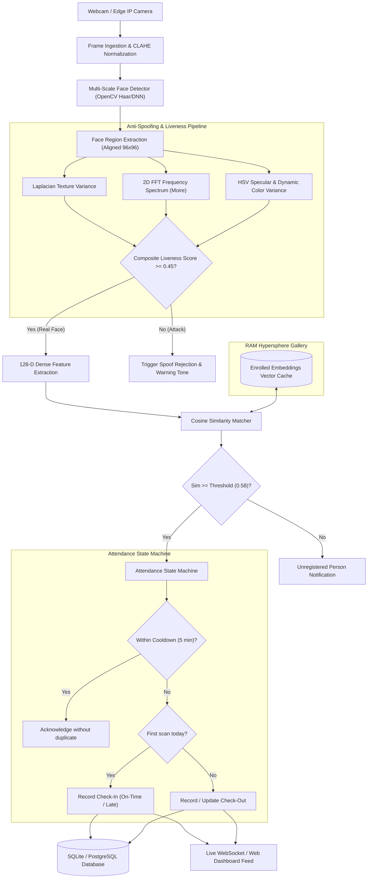

# 🌟 VisionAttend AI: Enterprise Face Biometric & Attendance Intelligence

[](https://python.org)
[](https://fastapi.tiangolo.com)
[](https://opencv.org)
[](https://opensource.org/licenses/MIT)
[](#anti-spoofing--liveness-engine)

**VisionAttend AI** is a state-of-the-art, enterprise-grade autonomous facial recognition attendance intelligence platform. Built with Python 3.12, FastAPI, and OpenCV, it eliminates buddy punching, time theft, and presentation attacks through multi-factor liveness detection, L2-normalized hypersphere biometric matching, and automated shift punctuality enforcement.

---

## ⚡ Key Highlights & Capabilities

- 👁️ **Autonomous Face Kiosk**: Zero-contact continuous facial scan directly in any web browser or via native standalone desktop OpenCV window.
- 🛡️ **Multi-Tier Anti-Spoofing Engine**:
  - **Laplacian Blur & Texture Variance**: Prevents static paper print attacks.
  - **2D FFT Frequency Analysis**: Detects LCD / OLED digital screen moiré patterns.
  - **Specular Reflection & Color Depth**: Blocks tablet and phone replay attacks.
- 📐 **Normalized Biometric Hypersphere**:
  - Extracts 128-dimensional dense spatial & gradient representation vectors ($\|v\|_2 = 1.0$).
  - Cosine similarity matching ($S_c \ge 0.58$) against an in-memory RAM cache for sub-120ms verification.
- ⏱️ **Intelligent Punctuality & Anti-Passback**:
  - Auto determines **On-Time** vs **Late** arrival according to customizable shift schedules (`09:30:00`).
  - Automatic check-out handling with cooldown enforcement (5-minute anti-passback duplicate guard).
- 📊 **Executive Analytics Dashboard**:
  - Interactive Chart.js hourly arrival curves and department turnout breakdown.
  - Live verification stream with instant status badges.
- 📑 **Enterprise Reporting**:
  - One-click export to standard CSV or stylized Microsoft Excel (`.xlsx`) workbooks.
- 🎵 **Audio Feedback**:
  - Synthesized Web Audio API chords for verified check-in, soft acknowledge tones for cooldown, and alarm tones for spoof attempts.

---

## 🏗️ System Architecture



---

## 🚀 Quick Start Guide

### 1. Prerequisites
- Python 3.12+ installed
- Webcam or USB camera connected

### 2. Installation & Setup
```bash
# Clone the repository
git clone https://github.com/Vaibhav007-star/AI-Attendance-System.git
cd AI-Attendance-System

# Create Python virtual environment
python -m venv .venv

# Activate virtual environment
# Windows:
.\.venv\Scripts\activate
# Linux/macOS:
source .venv/bin/activate

# Install dependencies
pip install -r requirements.txt
```

### 3. Initialize Database & Seed Defaults
```bash
python run.py --init-db
```
Default administrator credentials:
- **Email**: `admin@visionattend.ai`
- **Password**: `Admin@123`

### 4. Run Web Application
```bash
python run.py
```
Open your browser and navigate to:
- 👁️ **Live Camera Kiosk**: [http://localhost:8000/kiosk](http://localhost:8000/kiosk)
- 📊 **Analytics Dashboard**: [http://localhost:8000/dashboard](http://localhost:8000/dashboard)
- 👥 **Employee & Biometrics**: [http://localhost:8000/employees](http://localhost:8000/employees)
- 📑 **Attendance Logs & Export**: [http://localhost:8000/records](http://localhost:8000/records)
- 📡 **Interactive Swagger API**: [http://localhost:8000/docs](http://localhost:8000/docs)

### 5. Run Native Standalone Desktop Kiosk (Optional)
To launch the high-speed desktop OpenCV window with local audio:
```bash
python run.py --desktop
```

---

## 📡 REST API Reference

| Endpoint | Method | Description |
|---|---|---|
| `/api/v1/recognition/verify` | `POST` | Live frame verification, liveness scoring & auto-attendance |
| `/api/v1/recognition/enroll` | `POST` | Registers facial features into biometric profile |
| `/api/v1/attendance/logs` | `GET` | Filter attendance logs by date, department, or status |
| `/api/v1/attendance/export/csv` | `GET` | Download full attendance records as CSV |
| `/api/v1/attendance/export/excel`| `GET` | Download styled Excel (.xlsx) workbook |
| `/api/v1/dashboard/stats` | `GET` | Real-time KPIs, arrival velocity, and department stats |
| `/api/v1/users` | `GET/POST`| Staff directory management and creation |
| `/api/v1/auth/login` | `POST` | JWT Bearer authentication |

---

## 📂 Project Structure

```
AI-Attendance-System/
├── MASTER_PROMPT.md            # Comprehensive AI Master Prompt & Blueprint
├── README.md                   # System documentation and manuals
├── requirements.txt            # Python dependencies
├── .env.example                # Environment variable template
├── run.py                      # Application launcher (Web & Desktop modes)
├── desktop_kiosk.py            # Standalone OpenCV Desktop Kiosk application
├── app/
│   ├── main.py                 # FastAPI application & lifespan management
│   ├── config.py               # Pydantic configuration settings
│   ├── core/
│   │   ├── database.py         # SQLAlchemy engine & session manager
│   │   ├── security.py         # JWT tokens & bcrypt password hashing
│   │   └── exceptions.py       # Custom biometric & liveness exceptions
│   ├── models/                 # Database schema models (User, Biometric, Attendance)
│   ├── schemas/                # Pydantic validation schemas
│   ├── services/
│   │   ├── face_engine.py      # Face detection, 128-D embedding & cosine matcher
│   │   ├── liveness_detector.py# Multi-factor presentation attack analyzer
│   │   ├── attendance_service.py # Punctuality rules, cooldown & auto-checkout
│   │   └── export_service.py   # CSV & Styled Excel generator
│   ├── api/v1/                 # Modular RESTful API routers
│   ├── static/                 # Styles, scripts, and sound assets
│   └── templates/              # Modern Cyber-Glass Jinja2 templates
└── storage/                    # Biometric avatars and attendance snapshots
```

---

## 📜 License
This project is open-source under the [MIT License](LICENSE).
